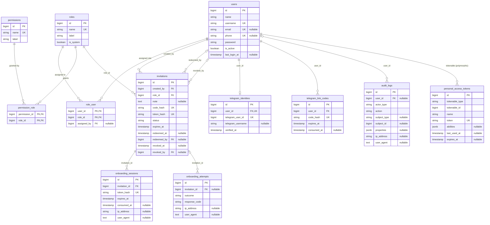

# Xibra Platform — Database Documentation

## 1. Overview

PostgreSQL is the primary relational database for Xibra Platform.

The database is managed exclusively by `xibra-api`.

All other applications must access platform data through documented API endpoints.

The database is the authoritative source of truth for platform records.

Xibra Platform uses one shared database to serve multiple independent users. Private records must follow explicit ownership and authorization rules.

## 2. Database Ownership

The following rules are mandatory:

1. `xibra-api` owns the database connection.
2. Only `xibra-api` executes database queries.
3. Frontend applications must never connect directly to PostgreSQL.
4. Telegram Bot and Hermes must communicate through `xibra-api`.
5. Business rules and data integrity must be enforced by the backend.
6. The database must remain the primary source of truth.
7. Database credentials must not be distributed to client applications.

## 3. Database Design Principles

- Use relational modeling where appropriate.
- Define primary keys explicitly.
- Define foreign keys for relational integrity.
- Add unique constraints where required.
- Use appropriate indexes for frequently queried fields.
- Use explicit nullability rules.
- Avoid storing duplicated authoritative data.
- Use transactions for operations involving multiple related records.
- Store timestamps consistently and handle application time zones explicitly.
- Avoid premature optimization and unnecessary tables.
- Use database constraints to enforce critical integrity requirements.
- Define deletion and retention behavior deliberately.
- Keep schema design consistent with Laravel and PostgreSQL capabilities.

## 4. Multi-User Data Ownership and Isolation

Xibra Platform uses a shared database for multiple independent users.

Private user-owned records must have an explicit ownership relationship.

### 4.1 Ownership Rules

- Use `user_id` to associate private records with their owning user where appropriate.
- Define foreign keys for ownership relationships.
- Validate ownership through the API on every private operation.
- Never trust a client-provided `user_id` as proof of authorization.
- Prevent unauthorized ownership reassignment.
- Apply ownership rules to nested and related records.
- Define explicit sharing relationships if cross-user access is introduced.
- Do not assume that a platform role grants unrestricted access to private records.

The concrete conventions for user-owned tables, nested resources, policy enforcement, and cross-user responses are recorded in ADR 0003. Private records are always resolved through the authenticated user's relationship; a request for another user's record returns `404` rather than `403` so private record existence does not leak.

### 4.2 Shared and System Data

Not every record requires a `user_id`.

Shared reference data, platform configuration, and system-level records may be global when their purpose requires it.

Each table must have a clearly documented ownership model:

- User-owned.
- Shared reference.
- System-managed.

The current tables are classified as follows. A new table must be added to this list in the same change that introduces it.

| Table | Classification | Ownership / access rule |
|---|---|---|
| `users` | System-managed | Identity record. A user can read their own profile; profile update, when added, is scoped to the same user. Lifecycle changes require `users.manage` (ADR 0002). |
| `roles` | Shared reference | Global role catalog. |
| `permissions` | Shared reference | Global permission catalog. |
| `role_user` | Shared reference | User-role assignment pivot. |
| `permission_role` | Shared reference | Role-permission assignment pivot. |
| `invitations` | System-managed | Owner-created and Owner-managed; the invitee does not own the record. |
| `onboarding_sessions` | System-managed | Short-lived, owned by the invitation it was opened for. |
| `onboarding_attempts` | System-managed | Append-only security history; Owner-only read (ADR 0004). |
| `audit_logs` | System-managed | Append-only audit history; Owner or self-scoped read (ADR 0004). |
| `telegram_identities` | User-owned | One row per linked account; access only through the owning user. |
| `telegram_link_codes` | User-owned | One active code per account; access only through the owning user. |
| `personal_access_tokens` | User-owned | Polymorphic tokens; access only through the owning tokenable user. |

Do not introduce ambiguous ownership behavior.

### 4.3 Data Isolation

The API must enforce user isolation independently of database query filtering performed by clients.

Database relationships and constraints should support the ownership model.

Tests must verify that one user cannot access or modify another user's private records.

## 5. Naming Conventions

| Element | Convention | Example |
|---|---|---|
| Tables | Plural snake_case | `blog_posts` |
| Columns | snake_case | `created_at` |
| Primary keys | `id` | `id` |
| Foreign keys | Singular model name plus `_id` | `user_id` |
| Indexes | Framework-generated names where practical | `users_email_unique` |
| Pivot tables | Consistent relationship naming | `project_tag` |

Laravel migrations and Eloquent conventions should be followed unless a documented reason requires an exception.

Primary and foreign key types must match.

Existing application tables and framework integrations must be inspected before introducing a different key strategy.

## 6. Migrations

- Every schema change must be represented by a migration.
- Migrations must be committed to Git.
- Migrations must be reviewed before production execution.
- Avoid editing migrations that have already been deployed to shared environments.
- Use new migrations for subsequent schema changes.
- Test migrations against a clean development database.
- Consider rollback behavior before applying schema changes.
- Preserve compatibility with existing Laravel framework tables.
- Review foreign keys, indexes, nullability, and deletion behavior before deployment.
- Never execute destructive migrations against production without an approved backup and recovery plan.

Migration history is part of the application's deployment contract.

Existing migration files must be inspected before planning additional schema changes.

## 7. Identity and Access Control

The database must support centralized identity and authorization.

Planned identity and access entities include:

- Users.
- Roles.
- Permissions.
- User-role assignments.
- Role-permission assignments.
- User invitations.
- Authentication tokens.

### 7.1 User Identity

User accounts must support:

- Required unique usernames.
- Optional unique email addresses.
- Optional unique phone numbers.
- Secure password storage.
- Account status.
- Relevant verification timestamps.

Login identifiers must follow consistent normalization rules.

Phone numbers must use a consistent international format.

### 7.2 Roles and Permissions

Roles and permissions must be modeled separately.

A role groups permissions, while a user receives roles through an explicit assignment.

Resource ownership remains a separate authorization requirement.

The initial platform roles may include `owner` and `member`.

Do not assume that a role alone grants access to every record.

### 7.3 Invitation Records

Invitation records must support:

- Issuing user.
- Assigned role.
- Optional recipient information.
- Hashed invitation secrets.
- Expiration timestamp.
- Redemption timestamp.
- Revocation timestamp.
- Current invitation state.

Invitation redemption must be atomic and one-time.

Raw invitation codes and link tokens must not be stored in plaintext.

### 7.4 Initial Owner Provisioning

The initial Owner account must be provisioned through a controlled process.

Public self-registration must remain disabled.

Seeders must not contain committed production passwords or reusable authentication secrets.

Initial Owner provisioning must not silently create duplicate accounts or grant unintended privileges.

### 7.5 Core Multi-User ERD

The current core schema is summarized below. It covers identity, authorization, invitation, onboarding, Telegram linking, audit, and token storage. Future domain tables use the ownership rules in section 4 and ADR 0003.

Notes:

- `personal_access_tokens` uses a polymorphic `tokenable` relationship; in practice the tokenable is always a `User` for API tokens.
- `onboarding_attempts.invitation_id` is nullable because an unknown secret or session token cannot be attributed to an invitation. Attempts survive invitation deletion.
- `audit_logs.user_id` is nullable so service and system actions without a specific user can be recorded.
- `role_user.assigned_by` references the user who made the assignment.
- The full invitation secret lifecycle is normalized into hashes; raw codes and link tokens are never stored.

## 8. Seeders

Seeders provide controlled initial and reference data.

Planned uses include:

- Initial Owner provisioning.
- Default roles and permissions.
- Reference categories.
- Default configuration.
- Required system records.

Seeders must be repeatable where practical.

Never hardcode production passwords or secrets in committed seeders.

Administrator provisioning must use a controlled and secure process because public registration is not part of the platform.

Separate reference-data seeders from account-provisioning procedures where appropriate.

## 9. Data Integrity

- Enforce required relationships through foreign keys.
- Use database constraints for critical integrity rules.
- Validate incoming data through the API.
- Use database transactions for multi-step operations.
- Define deletion behavior deliberately.
- Prevent unauthorized access to records.
- Maintain consistent ownership rules for personal data.
- Use unique constraints to prevent duplicate identities and relationships.
- Prevent invalid state transitions where database constraints can safely enforce them.
- Ensure related records remain consistent after updates and deletions.

Important multi-step operations, such as invitation redemption and account creation, must use database transactions.

## 10. Indexing

Indexes should be introduced based on actual query patterns.

Consider indexing:

- Foreign keys.
- Frequently filtered columns.
- Frequently sorted columns.
- Unique identifiers.
- Common lookup combinations.
- Ownership columns used in private resource queries.
- Columns used in invitation status and expiration lookups.

Avoid adding indexes without considering write overhead and storage cost.

Review query plans when performance problems appear.

## 11. Integrations and Sensitive Data

External integrations belong to individual users.

Integration records must have explicit user ownership where applicable.

Sensitive integration credentials must:

- Be encrypted at rest.
- Never be returned in ordinary API responses.
- Never be written to application logs.
- Be accessible only through authorized backend operations.
- Support revocation and disconnection.
- Be isolated between users.

OAuth access and refresh tokens must not be stored as plaintext.

AI conversations, memory, and activity records must also follow user isolation rules.

Do not store unnecessary sensitive information in AI context or operational logs.

## 12. Auditability and Approval Records

Sensitive platform operations should have an auditable history.

Depending on the operation, records may include:

- Acting user or service identity.
- Action type.
- Affected resource.
- Relevant timestamps.
- Approval status.
- Approval actor.
- Execution outcome.

Audit records must not contain passwords, access tokens, raw invitation secrets, or other sensitive credentials.

Audit retention and access rules are defined in ADR 0004: onboarding attempts are retained for 90 days, audit logs for 365 days, and reads are either Owner-wide or scoped to the authenticated user's own records. Retention is enforced by a scheduled prune command.

## 13. Deletion and Data Retention

Deletion behavior must be defined for each data domain.

Before introducing cascading deletes, determine whether related records must be retained for operational, financial, security, or audit purposes.

The design must distinguish between:

- Hard deletion.
- Soft deletion.
- Account deactivation.
- Anonymization.
- Retention of required audit records.

Deleting a user must not accidentally destroy records that must legally or operationally be retained.

Data retention policies must be documented before production implementation.

v1 uses account deactivation rather than deletion (ADR 0002). There is no user or aggregate delete endpoint. All ownership foreign keys have deliberate deletion behavior; retained records use `restrictOnDelete`, and only records that cannot exist independently use `cascadeOnDelete`. A future deletion or anonymization procedure must be recorded as its own decision before any endpoint is added.

## 14. Database Security

- Keep PostgreSQL inaccessible from public networks unless explicitly required by a reviewed architecture decision.
- Use a dedicated database role for the API.
- Apply least-privilege permissions.
- Store credentials in environment configuration.
- Never commit database passwords.
- Back up data before destructive operations.
- Verify backup restoration periodically.
- Restrict database administrative access.
- Protect database backups with appropriate access controls and encryption.
- Never expose database credentials to frontend applications, Telegram Bot, or Hermes.

## 15. Backup and Recovery

Production database operations must include:

- Scheduled backups.
- Secure backup storage.
- Documented retention policy.
- Backup integrity checks.
- Tested restoration procedures.
- Documented recovery steps.
- Defined recovery objectives where appropriate.

A backup is not considered reliable until restoration has been tested.

Destructive database changes must have an approved recovery plan.

## 16. Planned Data Domains

The following domains are planned for gradual implementation:

- Identity and access.
- Invitation and onboarding.
- Portfolio content.
- Productivity.
- Schedule and workforce.
- Personal finance.
- Knowledge management.
- AI activity and approvals.
- Integrations and notifications.

These domains are architectural planning categories, not existing database tables.

Each domain must be designed and reviewed before its migrations are implemented.

Finance and other future domains must not be introduced into the initial schema without an approved implementation scope.

## 17. Implementation Status

This document establishes database design principles.

It does not imply that the complete production schema, migrations, seeders, backups, or all planned domains already exist.

Implementation progress must be tracked in the root `TODO.md` and verified against actual migrations, database structure, application code, and automated tests.